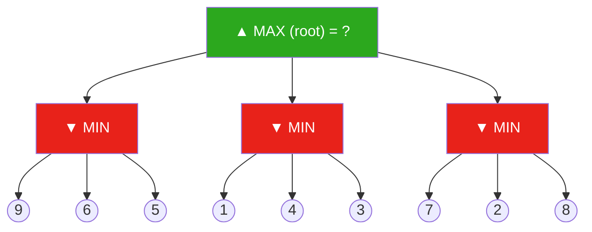

# CS50 AI — Quiz 0: Search

> [CS50's Introduction to Artificial Intelligence with Python](https://cs50.harvard.edu/ai/quizzes/0/)

---

## Question 1

Between depth first search (DFS) and breadth first search (BFS), which will find a shorter path through a maze?

- [ ] DFS will always find a shorter path than BFS
- [ ] BFS will always find a shorter path than DFS
- [ ] DFS will sometimes, but not always, find a shorter path than BFS
- [x] **BFS will sometimes, but not always, find a shorter path than DFS**
- [ ] Both algorithms will always find paths of the same length

**✅ Answer / Resposta:** Breadth first search will sometimes, but not always, find a shorter path than depth first search

### 📘 DFS vs BFS — Resumo

```
        A
      /   \
     B     C
    / \   / \
   D   E F   G
```

| Algoritmo | Ordem de exploração | Ideia |
|---|---|---|
| **DFS** (Depth-First) | A → B → D → E → C → F → G | Vai **ao fundo** de um ramo e depois recua |
| **BFS** (Breadth-First) | A → B → C → D → E → F → G | Explora **nível a nível**, como uma onda |

| | DFS | BFS |
|---|---|---|
| Fronteira | **Pilha** (stack): último a entrar, primeiro a sair | **Fila** (queue): primeiro a entrar, primeiro a sair |
| Caminho mais curto? | ❌ Nem sempre | ✅ Sempre (se os passos custarem o mesmo) |
| Memória | Pouca (só o ramo atual) | Muita (o nível inteiro) |
| Analogia | Seguir uma parede do labirinto até ao fim | Ondas de uma pedra num lago |

Em código só muda uma linha:

```python
node = frontier.pop()     # DFS: tira o último (pilha)
node = frontier.pop(0)    # BFS: tira o primeiro (fila)
```

> **Resumo:** precisas do caminho mais curto → **BFS**. Pouca memória ou objetivo provavelmente fundo → **DFS**.

---

## Question 2

Consider the below maze. Grey cells indicate walls. A search algorithm was run on this maze, and found the yellow highlighted path from point A to B. In doing so, the red highlighted cells were the states explored but that did not lead to the goal.

```
⬜⬛⬜⬜⬜⬛⬜⬜⬛🅱️🟨🟨
⬜⬛⬜⬛⬜⬜⬜⬛⬛⬛⬛🟨
⬜⬜⬜⬛⬜⬛⬜⬜⬛🟥🟥🟨
⬛⬜⬛⬛⬜⬛⬜⬛⬜⬛⬛🟨
⬛⬛⬛⬜⬜⬛⬜⬛⬜🟨🟨🟨
🟥⬛⬛⬛⬛⬛⬜⬛⬛🟨⬛⬛
🟥⬛⬛⬛🟨🟨🟨⬛⬛🟨⬛⬛
🅰️🟨🟨🟨🟨⬛🟨🟨🟨🟨⬜⬛
```

> ⬛ wall · ⬜ free (not explored) · 🟨 path found · 🟥 explored, dead end · 🅰️ start · 🅱️ goal

Of the four search algorithms discussed in lecture — depth-first search, breadth-first search, greedy best-first search with Manhattan distance heuristic, and A* search with Manhattan distance heuristic — which one (or multiple, if multiple are possible) could be the algorithm used?

- [ ] Could only be A*
- [ ] Could only be greedy best-first search
- [x] **Could only be DFS**
- [ ] Could only be BFS
- [ ] Could be either A* or greedy best-first search
- [ ] Could be either DFS or BFS
- [ ] Could be any of the four algorithms
- [ ] Could not be any of the four algorithms

**✅ Answer / Resposta:** Could only be DFS
### Porquê
O ponto-chave é o topo do pequeno "degrau" a meio do caminho (na linha de baixo, onde o caminho sobe, vai para a direita e volta a **descer**). Nessa célula há uma célula livre (⬜) **logo acima**, que dá para um corredor comprido a subir em direção à linha do B. Essa célula **não foi explorada** (está ⬜, não 🟥).
- **Greedy best-first (Manhattan):** a célula de cima está **mais perto** de B (menor distância de Manhattan) do que a célula de baixo que o caminho seguiu. O greedy tê-la-ia expandido primeiro. ❌
- **A\* (Manhattan):** as duas células têm o mesmo `g(n)`, mas a de cima tem menor `h(n)`, logo menor `f(n) = g(n) + h(n)`. O A\* tê-la-ia expandido primeiro. ❌
- **BFS:** essa célula está a 8 passos de A, enquanto B está a 22. O BFS explora todos os estados mais próximos do que o objetivo antes de lá chegar, por isso teria explorado essa célula (e o corredor todo). ❌
- **DFS:** escolhe um vizinho e segue-o até um beco sem saída, depois recua — as células vermelhas são becos curtos (duas acima de A, duas perto de B) e muitas células alcançáveis nunca foram tocadas. Encaixa no DFS a ter "sorte" nas escolhas. ✅

### 📘 Algoritmos de procura — Resumo

| Algoritmo | Fronteira | Escolhe a seguir | Usa heurística? | Ótimo? |
|---|---|---|---|---|
| **DFS** | Pilha | O nó mais recente | ❌ | ❌ |
| **BFS** | Fila | O nó mais antigo | ❌ | ✅ (custos iguais) |
| **Greedy best-first** | Fila de prioridade | Menor `h(n)` | ✅ | ❌ |
| **A\*** | Fila de prioridade | Menor `g(n) + h(n)` | ✅ | ✅ (se `h` for admissível e consistente) |

- `g(n)` = custo do início até `n`
- `h(n)` = custo estimado até ao objetivo (ex.: distância de Manhattan)
- **Distância de Manhattan:** `|x1 − x2| + |y1 − y2|` (passos ignorando paredes)
- **Não informados:** DFS, BFS (não sabem onde está o objetivo)
- **Informados:** Greedy, A\* (usam `h(n)` para guiar a procura)

> **Resumo:** o DFS vai ao fundo, o BFS vai em largura, o Greedy vai na direção do objetivo e o A\* também, mas conta o custo já percorrido.


---

## Question 3

Why is depth-limited minimax sometimes preferable to minimax without a depth limit?

- [x] **Depth-limited minimax can arrive at a decision more quickly because it explores fewer states**
- [ ] Depth-limited minimax will achieve the same output as minimax without a depth limit, but can sometimes use less memory
- [ ] Depth-limited minimax can make a more optimal decision by not exploring states known to be suboptimal
- [ ] Depth-limited minimax is never preferable to minimax without a depth limit

**✅ Answer / Resposta:** Depth-limited minimax can arrive at a decision more quickly because it explores fewer states

### 🇵🇹 Porquê
- O minimax sem limite explora a árvore **até aos estados terminais**. Em jogos como o xadrez, o número de estados é astronómico (~10^120 jogos possíveis) → impossível em tempo útil.
- Com limite de profundidade, para ao fim de *n* jogadas e usa uma **função de avaliação** para estimar o valor desse estado. Explora muito menos estados → decide **mais rápido**.
- Porque as outras estão erradas:
  - *"Mesmo resultado"* → falso: como usa estimativas, pode dar uma decisão **diferente** (e pior).
  - *"Decisão mais ótima"* → falso: o minimax completo é ótimo; o limitado só pode ser igual ou pior. (Cortar estados sabidamente subótimos é o **alpha-beta pruning**, outra técnica.)
  - *"Nunca é preferível"* → falso: na prática é a única opção viável em jogos grandes.

---

## Question 4

Consider the Minimax tree below, where the green up arrows indicate the MAX player and red down arrows indicate the MIN player. The leaf nodes are each labelled with their value.



What is the value of the root node?

**✅ Answer / Resposta:** `5`

### 🇬🇧 Why
Minimax evaluates the tree **bottom-up**:
1. Start at the leaves (given values).
2. Each **MIN** node (red ↓ arrow) takes the **smallest** value of its children — the opponent picks the move that's worst for us.
3. Each **MAX** node (green ↑ arrow) takes the **largest** value of its children — we pick the best move.
4. Repeat level by level up to the root (MAX).

Applied to this tree:

| MIN node | Children | Value (min) |
|---|---|---|
| Left | 9, 6, 5 | **5** |
| Middle | 1, 4, 3 | **1** |
| Right | 7, 2, 8 | **2** |

Root (MAX) = max(5, 1, 2) = **5**

Note: the leaf 9 is the biggest value, but MAX can't reach it — if MAX picks the left branch, MIN will answer with 5.

### 🇵🇹 Porquê
O minimax avalia a árvore **de baixo para cima**:
1. Começa nas folhas (valores dados).
2. Cada nó **MIN** (seta vermelha ↓) fica com o **menor** valor dos seus filhos — o adversário escolhe a jogada pior para nós.
3. Cada nó **MAX** (seta verde ↑) fica com o **maior** valor dos seus filhos — nós escolhemos a melhor jogada.
4. Repete-se nível a nível até à raiz (MAX).

Aplicado a esta árvore:

| Nó MIN | Filhos | Valor (mín) |
|---|---|---|
| Esquerda | 9, 6, 5 | **5** |
| Meio | 1, 4, 3 | **1** |
| Direita | 7, 2, 8 | **2** |

Raiz (MAX) = max(5, 1, 2) = **5**

Nota: a folha 9 é o maior valor, mas o MAX não lhe consegue chegar — se escolher o ramo da esquerda, o MIN responde com 5.
