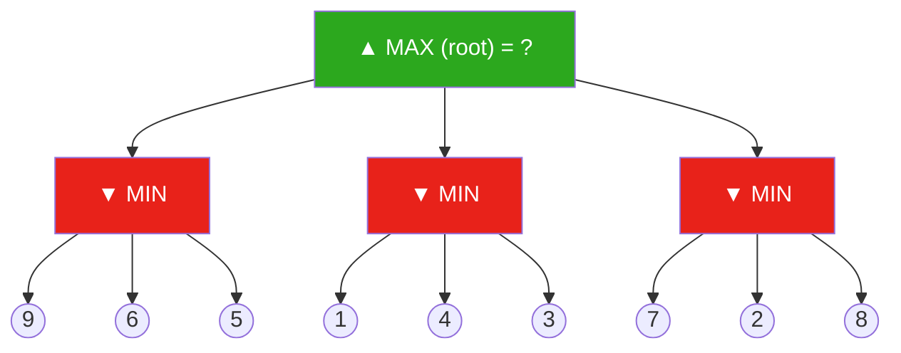

# CS50 AI — Quiz 0: Search

> [CS50's Introduction to Artificial Intelligence with Python](https://cs50.harvard.edu/ai/quizzes/0/)

---

## Question 1

Between depth first search (DFS) and breadth first search (BFS), which will find a shorter path through a maze?

- [ ] DFS will always find a shorter path than BFS
- [ ] BFS will always find a shorter path than DFS
- [ ] DFS will sometimes, but not always, find a shorter path than BFS
- [x] **BFS will sometimes, but not always, find a shorter path than DFS**
- [ ] Both algorithms will always find paths of the same length

**✅ Answer / Resposta:** BFS will sometimes, but not always, find a shorter path than DFS

### 🇬🇧 Why
- **BFS** uses a **queue** and explores the maze layer by layer: first all states 1 step away, then 2, and so on. So the first path it finds to the goal is **always the shortest** (when all steps cost the same).
- **DFS** uses a **stack** and follows one branch to the end before backtracking. The path it finds depends on the order it picks directions — it may be the shortest, but it can also be much longer.
- Therefore:
  - DFS **never** finds a shorter path than BFS (BFS already has the minimum) → rules out options 1 and 3.
  - BFS doesn't always win, because DFS can get "lucky" and find the same path → rules out option 2.
  - They aren't always equal, because DFS may find a longer path → rules out option 5.
  - What's left: BFS **sometimes** finds a shorter path.

### 🇵🇹 Porquê
- O **BFS** usa uma **fila** (queue) e explora o labirinto por camadas: primeiro todos os estados a 1 passo, depois a 2, etc. Por isso, o primeiro caminho que encontra até ao objetivo é **sempre o mais curto** (quando todos os passos custam o mesmo).
- O **DFS** usa uma **pilha** (stack) e segue um ramo até ao fim antes de recuar. O caminho que encontra depende da ordem em que escolhe as direções — pode ser o mais curto, mas também pode ser muito mais longo.
- Logo:
  - O DFS **nunca** encontra um caminho mais curto que o BFS (o BFS já tem o mínimo) → exclui as opções 1 e 3.
  - Nem sempre o BFS ganha, porque o DFS pode ter "sorte" e encontrar o mesmo caminho → exclui a opção 2.
  - Nem sempre são iguais, porque o DFS pode encontrar um caminho mais longo → exclui a opção 5.
  - Resta: o BFS encontra **às vezes** um caminho mais curto.

---

## Question 2

Consider the below maze. Grey cells indicate walls. A search algorithm was run on this maze, and found the yellow highlighted path from point A to B. In doing so, the red highlighted cells were the states explored but that did not lead to the goal.

```
⬜⬛⬜⬜⬜⬛⬜⬜⬛🅱️🟨🟨
⬜⬛⬜⬛⬜⬜⬜⬛⬛⬛⬛🟨
⬜⬜⬜⬛⬜⬛⬜⬜⬛🟥🟥🟨
⬛⬜⬛⬛⬜⬛⬜⬛⬜⬛⬛🟨
⬛⬛⬛⬜⬜⬛⬜⬛⬜🟨🟨🟨
🟥⬛⬛⬛⬛⬛⬜⬛⬛🟨⬛⬛
🟥⬛⬛⬛🟨🟨🟨⬛⬛🟨⬛⬛
🅰️🟨🟨🟨🟨⬛🟨🟨🟨🟨⬜⬛
```

> ⬛ wall · ⬜ free (not explored) · 🟨 path found · 🟥 explored, dead end · 🅰️ start · 🅱️ goal

Of the four search algorithms discussed in lecture — depth-first search, breadth-first search, greedy best-first search with Manhattan distance heuristic, and A* search with Manhattan distance heuristic — which one (or multiple, if multiple are possible) could be the algorithm used?

- [ ] Could only be A*
- [ ] Could only be greedy best-first search
- [x] **Could only be DFS**
- [ ] Could only be BFS
- [ ] Could be either A* or greedy best-first search
- [ ] Could be either DFS or BFS
- [ ] Could be any of the four algorithms
- [ ] Could not be any of the four algorithms

**✅ Answer / Resposta:** Could only be DFS

### 🇬🇧 Why
The key spot is the top of the small "bump" in the middle of the path (bottom row, where the path goes up, right, and back **down**). At that cell there is an free (⬜) cell **directly above** it, leading into a long open corridor going up towards B's row. That cell was **not explored** (it's ⬜, not 🟥).
- **Greedy best-first (Manhattan):** the cell above is **closer** to B (lower Manhattan distance) than the cell below that the path took. Greedy would have expanded it first. ❌
- **A\* (Manhattan):** both cells have the same `g(n)`, but the cell above has a smaller `h(n)`, so a smaller `f(n) = g(n) + h(n)`. A\* would have expanded it first. ❌
- **BFS:** that cell is only 8 steps from A, while B is 22 steps away. BFS explores every state closer than the goal before reaching it, so it would have explored that cell (and the whole corridor). ❌
- **DFS:** picks one neighbour and follows it until a dead end, then backtracks — the red cells are short dead ends (two above A, two near B), and many reachable cells were never touched. That fits DFS getting "lucky" on its branch choices. ✅

### 🇵🇹 Porquê
O ponto-chave é o topo do pequeno "degrau" a meio do caminho (na linha de baixo, onde o caminho sobe, vai para a direita e volta a **descer**). Nessa célula há uma célula livre (⬜) **logo acima**, que dá para um corredor comprido a subir em direção à linha do B. Essa célula **não foi explorada** (está ⬜, não 🟥).
- **Greedy best-first (Manhattan):** a célula de cima está **mais perto** de B (menor distância de Manhattan) do que a célula de baixo que o caminho seguiu. O greedy tê-la-ia expandido primeiro. ❌
- **A\* (Manhattan):** as duas células têm o mesmo `g(n)`, mas a de cima tem menor `h(n)`, logo menor `f(n) = g(n) + h(n)`. O A\* tê-la-ia expandido primeiro. ❌
- **BFS:** essa célula está a 8 passos de A, enquanto B está a 22. O BFS explora todos os estados mais próximos do que o objetivo antes de lá chegar, por isso teria explorado essa célula (e o corredor todo). ❌
- **DFS:** escolhe um vizinho e segue-o até um beco sem saída, depois recua — as células vermelhas são becos curtos (duas acima de A, duas perto de B) e muitas células alcançáveis nunca foram tocadas. Encaixa no DFS a ter "sorte" nas escolhas. ✅

---

## Question 3

Why is depth-limited minimax sometimes preferable to minimax without a depth limit?

- [x] **Depth-limited minimax can arrive at a decision more quickly because it explores fewer states**
- [ ] Depth-limited minimax will achieve the same output as minimax without a depth limit, but can sometimes use less memory
- [ ] Depth-limited minimax can make a more optimal decision by not exploring states known to be suboptimal
- [ ] Depth-limited minimax is never preferable to minimax without a depth limit

**✅ Answer / Resposta:** Depth-limited minimax can arrive at a decision more quickly because it explores fewer states

### 🇬🇧 Why
- Minimax without a limit explores the tree **all the way to terminal states**. In games like chess the number of states is astronomical (~10^120 possible games) → impossible in reasonable time.
- With a depth limit, it stops after *n* moves and uses an **evaluation function** to estimate the value of that state. It explores far fewer states → decides **faster**.
- Why the others are wrong:
  - *"Same output"* → false: since it uses estimates, it may give a **different** (and worse) decision.
  - *"More optimal decision"* → false: full minimax is optimal; the limited version can only be equal or worse. (Skipping states known to be suboptimal is **alpha-beta pruning**, a different technique.)
  - *"Never preferable"* → false: in practice it's the only viable option for large games.

### 🇵🇹 Porquê
- O minimax sem limite explora a árvore **até aos estados terminais**. Em jogos como o xadrez, o número de estados é astronómico (~10^120 jogos possíveis) → impossível em tempo útil.
- Com limite de profundidade, para ao fim de *n* jogadas e usa uma **função de avaliação** para estimar o valor desse estado. Explora muito menos estados → decide **mais rápido**.
- Porque as outras estão erradas:
  - *"Mesmo resultado"* → falso: como usa estimativas, pode dar uma decisão **diferente** (e pior).
  - *"Decisão mais ótima"* → falso: o minimax completo é ótimo; o limitado só pode ser igual ou pior. (Cortar estados sabidamente subótimos é o **alpha-beta pruning**, outra técnica.)
  - *"Nunca é preferível"* → falso: na prática é a única opção viável em jogos grandes.

---

## Question 4

Consider the Minimax tree below, where the green up arrows indicate the MAX player and red down arrows indicate the MIN player. The leaf nodes are each labelled with their value.



What is the value of the root node?

**✅ Answer / Resposta:** `5`

### 🇬🇧 Why
Minimax evaluates the tree **bottom-up**:
1. Start at the leaves (given values).
2. Each **MIN** node (red ↓ arrow) takes the **smallest** value of its children — the opponent picks the move that's worst for us.
3. Each **MAX** node (green ↑ arrow) takes the **largest** value of its children — we pick the best move.
4. Repeat level by level up to the root (MAX).

Applied to this tree:

| MIN node | Children | Value (min) |
|---|---|---|
| Left | 9, 6, 5 | **5** |
| Middle | 1, 4, 3 | **1** |
| Right | 7, 2, 8 | **2** |

Root (MAX) = max(5, 1, 2) = **5**

Note: the leaf 9 is the biggest value, but MAX can't reach it — if MAX picks the left branch, MIN will answer with 5.

### 🇵🇹 Porquê
O minimax avalia a árvore **de baixo para cima**:
1. Começa nas folhas (valores dados).
2. Cada nó **MIN** (seta vermelha ↓) fica com o **menor** valor dos seus filhos — o adversário escolhe a jogada pior para nós.
3. Cada nó **MAX** (seta verde ↑) fica com o **maior** valor dos seus filhos — nós escolhemos a melhor jogada.
4. Repete-se nível a nível até à raiz (MAX).

Aplicado a esta árvore:

| Nó MIN | Filhos | Valor (mín) |
|---|---|---|
| Esquerda | 9, 6, 5 | **5** |
| Meio | 1, 4, 3 | **1** |
| Direita | 7, 2, 8 | **2** |

Raiz (MAX) = max(5, 1, 2) = **5**

Nota: a folha 9 é o maior valor, mas o MAX não lhe consegue chegar — se escolher o ramo da esquerda, o MIN responde com 5.
